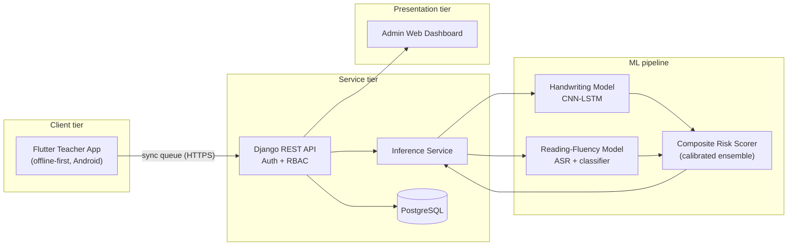

# ILM — Intelligent Literacy & Learning Monitor

### AI-Based Early Screening System for Dyslexia and Specific Learning Disabilities

> **ILM** (علم, *"knowledge"*) is a low-cost, teacher-administered screening system that flags early indicators of dyslexia and related Specific Learning Disabilities (SLDs) in Pakistani primary-school children, using **touchscreen handwriting dynamics** and **oral reading fluency** analysis.

> [!IMPORTANT]
> **This is a screening and referral-support tool, not a diagnostic instrument.**
> Every output is a *risk indicator requiring follow-up* by a qualified clinical psychologist or special-education professional. It must never be used to label a child.

---

## Table of Contents

- [Why This Project](#why-this-project)
- [How It Works](#how-it-works)
- [System Architecture](#system-architecture)
- [Repository Structure](#repository-structure)
- [Frontend Sprint Progress](#frontend-sprint-progress)
- [Tech Stack](#tech-stack)
- [Research Questions](#research-questions)
- [Getting Started](#getting-started)
- [Development Process](#development-process)
- [Testing Strategy](#testing-strategy)
- [Data Ethics & Privacy](#data-ethics--privacy)
- [Roadmap](#roadmap)
- [Team](#team)
- [License](#license)

---

## Why This Project

- Roughly **7%** of primary-school children show developmental dyslexia (pooled meta-analytic estimate), yet in under-resourced classrooms they are routinely mislabelled as "weak" or "inattentive" students.
- Pakistan has **fewer than 5 practising child psychiatrists** and **fewer than 500 registered clinical psychologists** for more than 60 million children under 14.
- Existing AI screening tools target English and other Latin-script languages. **No equivalent tooling exists for Urdu/English-medium instruction** or the Pakistani curriculum, where script direction, letter shaping, and phonology differ substantially.

ILM fills that gap: a screening layer that a classroom teacher (not a specialist) can run in a few minutes per child, so scarce specialist capacity reaches the children who need it most.

---

## How It Works

| Step | What happens |
|------|--------------|
| **1. Handwriting exercise** | The child copies age-appropriate Urdu/English letters, words and sentences on a tablet/phone. Stroke coordinates, timing and pressure (where supported) are logged. |
| **2. Oral reading exercise** | The child reads a short, grade-appropriate passage aloud under teacher supervision. A timestamped audio recording is captured. |
| **3. Feature extraction** | Handwriting: letter reversals, spacing consistency, stroke-timing variability, pressure variation. Reading: substitution rate, omission rate, hesitations/pauses, words per minute. |
| **4. Model inference** | A CNN-LSTM sequence model scores handwriting; an ASR + fluency classifier scores reading. |
| **5. Composite risk score** | A calibrated ensemble combines both signals, with the threshold tuned against clinician-labelled data. |
| **6. Dashboard & referral** | Administrators view flagged students by class, track risk trends over repeated screenings, and export referral summaries. |

---

## System Architecture



- **Client tier:** Flutter app for low-end Android devices. Exercises work fully offline and sync later through a local queue.
- **Service tier:** Django + Django REST Framework. Handles data intake, inference orchestration, storage and role-based access (teachers see only their own classes, administrators see school-wide data).
- **Presentation tier:** web dashboard served by the same backend for class-level risk views, longitudinal tracking and referral exports.

---

## Repository Structure

```
ILM-Intelligent-Literacy-Learning-Monitor/
├── mobile/                     # Flutter teacher & child app
│   ├── assets/fonts/           # Baloo 2, Atkinson Hyperlegible, Gulzar (SIL OFL)
│   ├── assets/mock/            # Invented sample data (API-contract shape)
│   ├── lib/core/               # Theme, design tokens, Urdu/English strings, models
│   ├── lib/data/               # Repository interface + mock implementation
│   ├── lib/shared/widgets/     # Direction B component library
│   ├── lib/features/           # Screens, one folder per feature
│   └── test/                   # Unit, widget and accessibility tests
├── backend/
│   └── dashboard/static/css/   # Generated design tokens for the web dashboard
├── design/tokens.json          # Single source of truth for colours, type, spacing
├── tools/gen_tokens.py         # Generates Dart + CSS tokens from design/tokens.json
├── docs/
│   ├── api-contract.yaml       # OpenAPI contract shared by app, dashboard, backend
│   └── testing/                # Test plan, test cases and gate reports (ISO/IEC/IEEE 29119-3)
└── .github/workflows/ci.yml    # Tokens check, format, analyze, tests, secret scan
```

---

## Frontend Sprint Progress

The frontend is built in a 2-week sprint of six phases. Each phase is merged through its own pull request and must pass its test gate.

| Phase | Scope | Status |
|-------|-------|--------|
| F1 · Days 1–2 | Project setup, design tokens, component library, CI | 🔄 In review |
| F2 · Days 3–4 | Teacher login, PIN, class register | ⏳ Planned |
| F3 · Days 5–7 | Child writing and reading screens | ⏳ Planned |
| F4 · Days 8–9 | Result screen, referral actions, full Urdu/English | ⏳ Planned |
| F5 · Days 10–12 | Admin web dashboard | ⏳ Planned |
| F6 · Days 13–14 | Regression, usability, acceptance | ⏳ Planned |

---

## Tech Stack

| Layer | Technologies |
|-------|--------------|
| Mobile app | Flutter (Dart), local storage + sync queue |
| Backend | Python, Django, Django REST Framework |
| Database | PostgreSQL |
| ML | Python, PyTorch / TensorFlow, ASR model fine-tuned for Urdu/English, scikit-learn |
| Dashboard | Django-served web app |
| Testing | pytest, Flutter widget tests, API contract tests |
| Training compute | Google Colab / cloud GPU |

---

## Research Questions

1. **RQ1** — Which touchscreen handwriting features (letter reversals, spacing irregularity, pressure variation, stroke timing) best predict dyslexia-risk indicators in Urdu/English-medium schoolchildren?
2. **RQ2** — Which oral-reading features (substitution rate, omission rate, hesitation frequency, reading pace) best distinguish at-risk readers from typically developing readers?
3. **RQ3** — Does a composite handwriting + reading score outperform either signal alone?
4. **RQ4** — Can teachers with no special-education training run the exercises reliably on a standard device within normal classroom time?

---

## Getting Started

> Setup steps will be finalised as each component lands. The commands below reflect the planned layout.

### Prerequisites

- Python 3.11+
- Flutter SDK (stable channel)
- PostgreSQL 15+
- Git

### Backend

```bash
cd backend
python -m venv .venv
source .venv/bin/activate        # Windows: .venv\Scripts\activate
pip install -r requirements.txt
cp .env.example .env             # set DB credentials and SECRET_KEY
python manage.py migrate
python manage.py createsuperuser
python manage.py runserver
```

### Mobile app

```bash
cd mobile
flutter pub get
flutter run                      # connect an Android device or emulator
```

### ML pipeline

```bash
cd ml
pip install -r requirements.txt
# training and evaluation entry points will be documented per module
```

---

## Development Process

The project follows an **Incremental model with Agile (Scrum-style) sprints inside each increment**. Requirements for the software parts are well defined, while the ML feature sets are a research question that depends on real, clinician-reviewed data.

| Increment | Deliverable |
|-----------|-------------|
| 1 | Data pipeline: capture logging, storage, clinician annotation workflow |
| 2 | Handwriting-analysis model |
| 3 | Oral-reading-fluency model |
| 4 | Composite risk scoring + threshold calibration |
| 5 | Flutter classroom-capture app |
| 6 | Django backend, REST API, inference service |
| 7 | Administrator web dashboard |
| 8 | Full system integration + pilot deployment |

Each increment closes with its own unit and integration tests.

---

## Testing Strategy

| Phase | Focus | Method |
|-------|-------|--------|
| Unit | Feature extractors, endpoints, widgets | pytest, Flutter widget tests |
| Integration | App ↔ backend ↔ inference ↔ dashboard | API contract tests, end-to-end capture-to-result flows |
| Model validation | Screening performance | Held-out split; **sensitivity, specificity, ROC-AUC** against clinician labels |
| Usability | Can teachers run it with minimal training? | Moderated teacher sessions; task completion & error rate |
| UAT | Does it meet staff needs? | Structured feedback with pilot-school staff |
| Pilot field test | Real classrooms: connectivity, devices, noise | Supervised run in 1–2 partner schools |

Error analysis will explicitly report behaviour on **left-handed writers** and **regional accent variation**.

---

## Data Ethics & Privacy

This project involves data from minors. The following rules are non-negotiable:

- **No real participant data is ever committed to this repository.** `data/` holds schemas and synthetic samples only. Real data lives in access-controlled storage.
- Data is collected only after **institutional ethical review**, **informed parental consent**, and **child assent**.
- Student identifiers are **anonymised** before any ML training.
- All data in transit uses **HTTPS**; access is restricted by **role-based access control**.
- Model outputs are worded as *risk indicators requiring follow-up*, never as diagnoses.

If you find sensitive data in this repo, open a private issue with the maintainers immediately.

---

## Roadmap

- [ ] Literature review & requirements
- [ ] Ethical approval & school partnerships
- [ ] Handwriting & reading-audio data collection
- [ ] Preprocessing & clinician annotation
- [ ] Handwriting model (CNN-LSTM)
- [ ] Reading-fluency model (ASR + classifier)
- [ ] Composite risk scoring & calibration
- [ ] Flutter teacher app
- [ ] Django backend & REST API
- [ ] Admin web dashboard
- [ ] System integration
- [ ] Pilot deployment, UAT & evaluation
- [ ] Final report & documentation

---

## Team

**Final Year Project — BS Software Engineering (2023–2027)**
Department of Software Engineering, University of South Asia

| Name | Roll No. |
|------|----------|
| Zain ul Abideen | b-29304 |
| Fatima Azam | b-29071 |
| Laiba Rashad | b-29313 |

**Supervisor:** Ma'am Zobia Zafar

---

## License

To be decided by the team and supervisor. Until a license is added, all rights are reserved by the authors and the University of South Asia.
